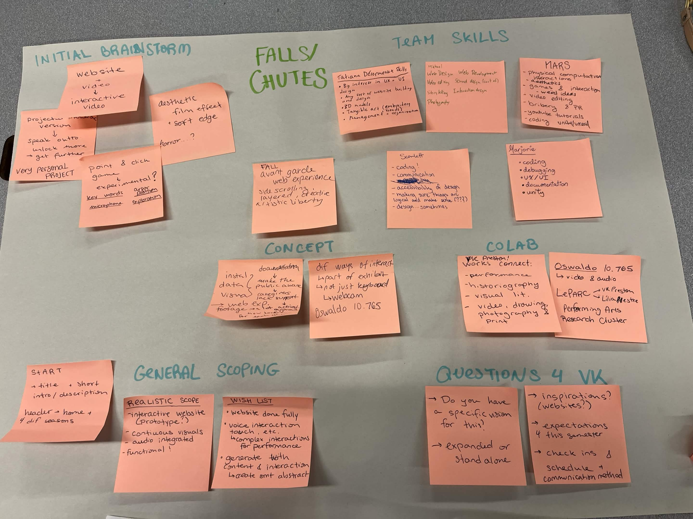

# CART 470 PROJECT PROCESS JOURNAL

## Project
Falls / Chutes by VK Preston

## Team members
1. Micheal Vlamis 
2. Mars Lapierre-Furtado
3. Tatiana Désormeaux
4. Marjorie Dudemaine
5. Scarlett Perez

## Week 2 Progress
During this week, we have communicated throughly as a team. We have concluded what are each other's strengths and weaknesses. But ultimately settled that we would not give each other roles until the moment that we manage to have a proper communication with our client VK Preston. As we want to keep their vision as intact as possible, we settled that it was the best solution.

However, this did not stop us from brainstorming possible options for what to do for the website that our client would want. From how the website would look to whatever extra things we might add. Finally, we have settled on what is the realistic scope to what would be our wishlist. 

Below is our joint notes of our meeting together in week 2:

## Week 3 Progress 
This week we have met up with VK Preston to communicate about their vision for the project.

It has been a very enlightening process as we manage to figure out a lot of questions that we had for them during this meeting. Thankfully, VK has a lot of support around concordia, which means we also have some of this support. VK has agreed to send us some of the assets thanks to Oswaldo who has the bulk of it saved. VK has also shown us multiple of the photographs so we may have more of  a vision for the project. 

## Week 4 Progress
Could not go to class because I was extremely sick the whole week. But did help the team into making the website's prototype with design choices in hopes to make a proper prototype for the next meeting we will have with VK.

## Week 5 Progress
Presented to VK the new and improved prototype where we remade our previous prototype using the parts of the previous prototype that VK did enjoy and parts that they liked.

However, once presented, VK did not seem too pleased with the new prototype as they did not enjoy previous design choices that they did like before. They did let us meet another one of their team who seemed very against our current prototype so we have redesigned it in hopes that VK is now content with the newest prototype.

## Week 6 Progress
Presented to VK the new NEW and improved prototype with some alternate options. They seemed much more pleased with this new prototype and allowed us to continue forward into making the website and starting with the code.

We also had talked with another one of the team who seemed to enjoy it as well. We had a couple of suggestions here and there for the website which we will try to implement as soon as the rest of the prototype has been coded into a usable website.

## Week 7 Progress
As a team, since we had the midterm presentation to make, we decided to work together into making the presentation while splitting off our workload. Currently, we have finished the presentation while working together as a team. Wanting to progress on both the website and the presentation, we split the team in half to focus on both things (the presentation and starting the website).

The presentation script and powerpoint were finished ahead of time and we split off the work accordingly for the presentation day.

## Week 8
This week we decided to split off our workload once again.

As a team, in theory, we will all work on the website together, however I'll admit we are a tad bit very disorganized and there isn't exactly a proper order of anything even if we try.

Nonetheless, my job right now is to learn the React library for the website as it was decided to do our website using it so right now I am supposed to learn it while the others split their workload in different ways. The decision for this was so I could learn the library first before my other two teammates who will have to learn it as well so I am the midpoint between the team on learning about React as two of our members already know it.

I feel that our workload could be split up differently and our organization could be different as well but the team desires this sort of organization so I will follow what they request of me and hopefully we can figure out a way to be more organized soon enough. Hopefully I can become more useful as I feel they never know what to do with me even when I offer so I will try to learn React fast enough for this.

## Week 9
This week is like the other weeks, we are splitting off the workload.

Truth be told, I think our team is a little bit disfunctional. I originally had offered to do whatever they left off but then the team didn't really leave anything to work and no one really wanted to give up their work so I couldn't really do anything.

Instead I have decided to offer to simply attempt to learn more of the website library.

Next week, I am hoping to suggest on taking the role of QA testing as I feel that we are severely lacking in that department and I feel it is a role that I can take since I feel underqualified at this point to work more on the website. I trust the rest of the team to figure it out and hopefully I can convince them to let me do more work over being on standby for presentations as that wasn't my original role from when we decided to give roles at the start of the semester.

Nonetheless, I am slowly learning the REACT library in my freetime during the week and I hope to become better.